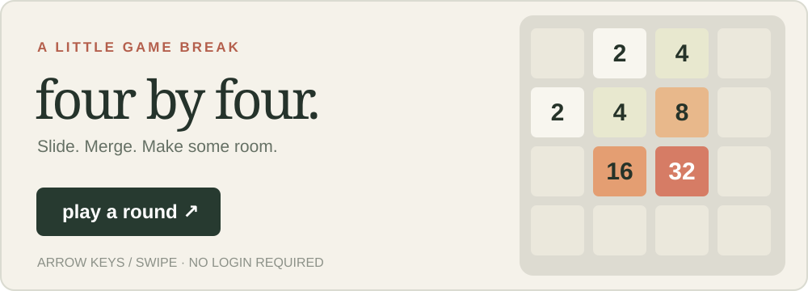

# Hey, I'm Laiba.

I build software, get curious about how things work, and end up making little projects about them.

I'm a software engineering intern working on native mobile experiences at **Shopify**, and I'm studying computer science at **Toronto Metropolitan University**. I care about the parts of software people actually feel — the details, the edge cases, and whether something makes sense when you use it.

Outside of mobile, I've been exploring search, applied ML, developer tools, and making AI systems a bit more dependable.

**A few things I keep coming back to:** Swift · Kotlin · Python · TypeScript · accessibility · retrieval · testing

---

### A little game break

I made a tiny number puzzle. It's the sort of thing you open for two minutes and accidentally play for twenty.

**[Play Four by Four ↗](https://laibaali0.github.io/Laiba-Ali/tiles/)** · [See the code](https://github.com/Laibaali0/Laiba-Ali/tree/main/docs/tiles) · [Try my other arcade game](https://laibaali0.github.io/Laiba-Ali/arcade/)

---

### A few projects

| Project | What it's about |
|---|---|
| [Chronicle RAG Lab](https://github.com/Laibaali0/Chronicle-RAG-Lab) | Making retrieval aware of dates, API versions, and where answers came from. |
| [Meridian ML Reliability](https://github.com/Laibaali0/Meridian-ML-Reliability) | Small experiments in agent behavior, inference scheduling, and evaluation. |
| [Advanced ML Systems](https://github.com/Laibaali0/Advanced-ML-Systems) | Search, offline policy evaluation, and model quantization reference code. |
| [Applied ML Experiments](https://github.com/Laibaali0/applied-ml-experiments) | Search and recommendation basics, plus an experiment tracker. |

All of these are learning projects built with example or synthetic data — not company code or production systems.

### Elsewhere

[Browse everything I've built](https://github.com/Laibaali0?tab=repositories) · [Visit my little corner of the web](https://laibaali0.github.io/Laiba-Ali/)
