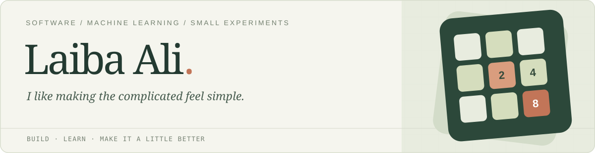
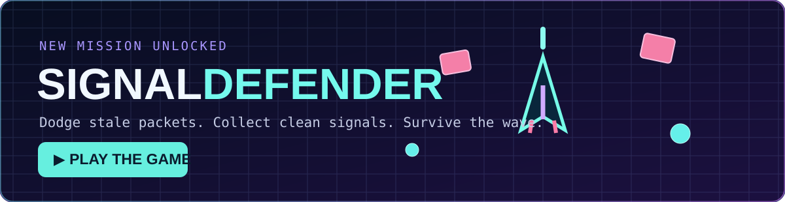

<div align="center">
  
</div>

<div align="center">
  <h3>Building useful things at the intersection of software engineering, mobile, and applied machine learning.</h3>
  <p>
    <a href="https://github.com/Laibaali0?tab=repositories"><b>01 / THE CODE</b></a> &nbsp;·&nbsp;
    <a href="https://github.com/Laibaali0/Chronicle-RAG-Lab"><b>02 / ML SYSTEMS</b></a> &nbsp;·&nbsp;
    <a href="https://laibaali0.github.io/Laiba-Ali/arcade/"><b>03 / THE ARCADE ↗</b></a>
  </p>
</div>

---

### `> whoami`

I'm **Laiba Ali** — a software engineering intern working on native mobile experiences and a computer science master's student. I'm drawn to complicated systems, thoughtful product details, and the freedom to learn something new every day.

I care about building things that are **useful, reliable, and understandable**. Lately, I've been exploring retrieval quality, LLM/agent reliability, evaluation, and the engineering behind AI experiences.

```txt
current_mode     learning by building
favorite_problem unfamiliar, messy, worth solving
focus            mobile engineering · applied ML · developer tools
side_quest       build an arcade, because why not?
```

### `> play --signal-defender`

<a href="https://laibaali0.github.io/Laiba-Ali/arcade/">
  
</a>

<p align="center"><i>Keyboard or touch controls · no account · no ads · high score saved on your device</i></p>

### `> ls ~/featured-projects`

| System | What you'll find |
| :--- | :--- |
| **[Chronicle RAG Lab](https://github.com/Laibaali0/Chronicle-RAG-Lab)** | Version-aware document retrieval, source validation, grounded answers, and offline evaluation |
| **[Meridian ML Reliability](https://github.com/Laibaali0/Meridian-ML-Reliability)** | Educational modules for inference scheduling, tool reliability, temporal evidence, and ML metrics |
| **[Advanced ML Systems](https://github.com/Laibaali0/Advanced-ML-Systems)** | Hybrid search, off-policy estimators, 4-bit quantization, and agent trace replay |
| **[Applied ML Experiments](https://github.com/Laibaali0/applied-ml-experiments)** | Search, recommendation baselines, and a simple experiment tracker |
| **[Laiba-Ali / Developer Arcade](https://github.com/Laibaali0/Laiba-Ali)** | Additional ML demos and the original, playable **Signal Defender** browser game |

### `> cat stack.txt`

**Engineering**  `Python` · `Swift` · `Kotlin` · `TypeScript` · `Git` · `CI` · `Testing`

**Currently exploring**  `Retrieval` · `Model evaluation` · `Agents` · `Quantization` · `ML infrastructure`

**Product mindset**  `Accessibility` · `Reliability` · `Mobile UX` · `Developer experience`

### `> open a conversation`

I'm interested in the people and systems behind ambitious engineering work — especially when the problem isn't completely figured out yet.

**[Explore my repositories](https://github.com/Laibaali0?tab=repositories)** · **[Browse the interactive portfolio](https://laibaali0.github.io/Laiba-Ali/)** · **[Play Signal Defender](https://laibaali0.github.io/Laiba-Ali/arcade/)**

<sub>**A note on the projects:** My public ML repositories are AI-assisted, educational reference implementations using synthetic/hand-authored datasets. They aren't employer code, deployed production systems, or evidence of external performance claims.</sub>
