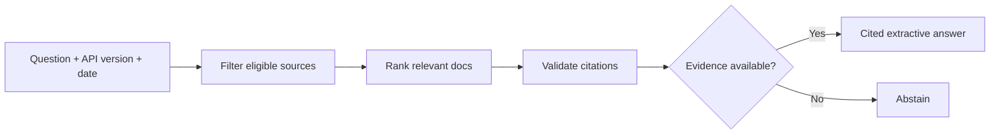

  

  <a href="https://laibaali0.github.io/Laiba-Ali/"><b>little corner of the internet</b></a> &nbsp;·&nbsp;
  <a href="https://laibaali0.github.io/Laiba-Ali/tiles/"><b>play a game</b></a> &nbsp;·&nbsp;
  <a href="https://www.linkedin.com/in/0laiba-ali/"><b>say hello</b></a>

## Hi, I'm Laiba.

I like learning how complicated things work and finding ways to make them simpler. These days I'm working on native mobile experiences at **Shopify**, while exploring the engineering side of machine learning: search, evaluation, agents and efficient inference.

I care about the details that are easy to miss — a form that keeps its state, a test that catches the weird case, or an AI answer that knows when its source is out of date.

| What I'm doing | What I keep exploring |
| --- | --- |
| Building mobile experiences with **Swift, Kotlin and TypeScript** | Retrieval, RL, LLM evaluation, GPU computing and developer tools |
| Getting more comfortable taking problems from design to tests | How to make systems more reliable, readable and useful |

### I made a little game, too.

Sometimes I make something just because it's fun. **Four by Four** is a small sliding-number puzzle with keyboard and touch controls. The game runs in your browser; no login or installation.

<a href="https://laibaali0.github.io/Laiba-Ali/tiles/"><b>Play Four by Four ↗</b></a> &nbsp;·&nbsp; <a href="https://github.com/Laibaali0/Laiba-Ali/tree/main/docs/tiles">See how it works</a> &nbsp;·&nbsp; <a href="https://laibaali0.github.io/Laiba-Ali/arcade/">Another game: Signal Defender</a>

## Things I've been building

A few small-to-medium, **AI-assisted learning projects** using synthetic and hand-authored data. They're deliberately open to inspection — you can read the implementation, run the tests and see what still needs work.

<table>
  <tr>
    <td width="50%" valign="top">
      <h3><a href="https://github.com/Laibaali0/Chronicle-RAG-Lab">Chronicle RAG Lab</a></h3>
      
<b>Can an AI assistant tell when documentation is stale?</b>

      
Version-aware retrieval, a small API, source citations and evaluation against a controlled fixture.

      Python · FastAPI · SQLite · BM25
    </td>
    <td width="50%" valign="top">
      <h3><a href="https://github.com/Laibaali0/Meridian-ML-Reliability">Meridian ML Reliability</a></h3>
      
<b>How do you test the messy bits of AI systems?</b>

      
Experiments with inference scheduling, tool permissions, temporal evidence and model evaluation.

      Python · Retrieval · Agents · Evaluation
    </td>
  </tr>
  <tr>
    <td width="50%" valign="top">
      <h3><a href="https://github.com/Laibaali0/Advanced-ML-Systems">Advanced ML Systems</a></h3>
      
<b>Little implementations of bigger ideas.</b>

      
Hybrid search, offline policy evaluation, groupwise INT4 quantization and deterministic tool replay.

      NumPy · Bandits · Quantization
    </td>
    <td width="50%" valign="top">
      <h3><a href="https://github.com/Laibaali0/applied-ml-experiments">Applied ML Experiments</a></h3>
      
<b>A place to try the fundamentals.</b>

      
Document search, a recommendation baseline and lightweight experiment tracking.

      Python · Search · Recommenders
    </td>
  </tr>
</table>

<b>One example: how Chronicle approaches an answer</b>

It's a reference design, not a deployed coding assistant. The example documents are synthetic and citation presence doesn't by itself guarantee factual support.

## A few tools and ideas on my desk

**Writing code** · `Python` `C++` `SQL` `Bash` `Swift` `Kotlin` `TypeScript`  
**Working with ML** · `PyTorch` `TensorFlow` `JAX` `Hugging Face` `scikit-learn`  
**Curious about** · `RAG` `Tool calling` `Offline RL` `Quantization` `CUDA` `ML systems`

## Elsewhere

<a href="https://www.linkedin.com/in/0laiba-ali/">LinkedIn</a> · <a href="https://laibaali0.github.io/Laiba-Ali/">Portfolio & games</a> · <a href="mailto:3260laiba@gmail.com">Email</a> · <a href="https://github.com/Laibaali0?tab=repositories">All repositories</a>

**A note on the code:** My public ML repos are learning/reference projects built with AI assistance and synthetic data. They don't contain employer code, production results or third-party benchmark claims.
